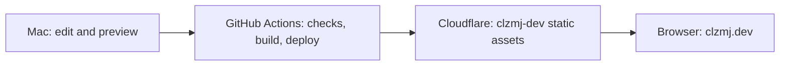

# clzmj.dev

Carlos Lezama’s personal site at **https://clzmj.dev** (`lib/site.ts`, `app/page.tsx`).

Sources: `.github/workflows/checks.yml`, `package.json`, `.github/workflows/deploy.yml`,
`wrangler.jsonc`, `infra/custom_domain.tf`.

| Task                        | Command from repo root                           |
| --------------------------- | ------------------------------------------------ |
| Install (Bun ≥1.3.14)       | `bun install`                                    |
| Build prerequisite          | `bunx playwright install chromium`               |
| Develop                     | `bun run dev`                                    |
| Build static `out/`         | `bun run build`                                  |
| Preview `out/` on port 3000 | `bun run start`                                  |
| Share local preview¹        | `cloudflared tunnel --url http://127.0.0.1:3000` |
| Test built export²          | `bun run test`                                   |
| Lint / format check         | `bun run lint` / `bun run format:check`          |
| Format / typecheck          | `bun run format` / `bun run typecheck`           |

Fetch sanitized photos before dev/build: [photo setup](docs/photos.md).

Commands: `package.json`; preview: `scripts/serve.ts`. ¹Optional quick tunnel; see
[operations](docs/operations.md). ²Install both test browsers with `bunx playwright install chromium
webkit` (`playwright.config.ts`).

| Folder                         | What lives there                                                                             |
| ------------------------------ | -------------------------------------------------------------------------------------------- |
| `app/`, `components/`          | Pages, metadata, styles, interactive UI                                                      |
| `lib/`, `content/`             | Loaders, photo manifest, profile, contribution snapshot                                      |
| `scripts/`, `tests/`           | Asset generation, static server, Playwright checks                                           |
| `assets/elsewhere/`, `public/` | Ignored photo sources; served artwork and generated assets                                   |
| `infra/`, `.github/workflows/` | Terraform; PR checks and production deployment                                               |
| `docs/`                        | [Architecture](docs/architecture.md), [environments](docs/environments.md), [CI](docs/ci.md) |

[Photos](docs/photos.md) · [Operations](docs/operations.md) · [ADRs](docs/adr/README.md) ·
[Design](docs/design.md) · [Infrastructure](infra/README.md)
