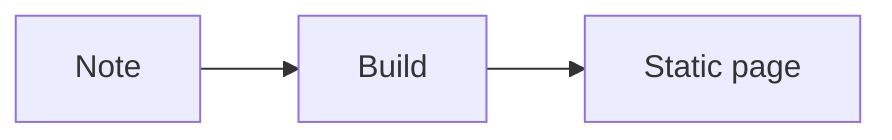

This post is a demo. It stays visible so the renderer has something to show. One config flag hides every post marked as a demo.

## Headings with anchors

A second-level heading gets an anchor link you can copy.

### A smaller heading

Third-level headings get an anchor too.

## Lists

Ordered:

1. First
2. Second
3. Third

Unordered:

- Pine
- Clay
- Ink

Tasks:

- [x] Render the demo
- [ ] Replace it with a real note

Inline `code` sits in a sentence, next to plain words.

## A code block

```ts
export function mexicoCityHour(date: Date): number {
  const hour = new Intl.DateTimeFormat("en-GB", {
    timeZone: "America/Mexico_City",
    hour: "2-digit",
    hourCycle: "h23",
  }).format(date);
  return Number(hour);
}
```

## A blockquote

> The page should feel quiet. The type does the talking, and the cat does the rest.

## A table

| Piece | Face | Use |
| --- | --- | --- |
| Name | Geist Serif | Display |
| Body | Geist Sans | Reading |
| Clock | Geist Mono | Data |

## A footnote

Mexico City sits at 19.43°N, 99.13°W.[^1]

[^1]: Coordinates for the header line, not a survey mark.

## Math

The inline form is $a^2 + b^2 = c^2$.

```math
\int_0^1 x^2 \, dx = \frac{1}{3}
```

## A figure

<figure>
  
  <figcaption>A caption under the figure.</figcaption>
</figure>

## A diagram



## A callout

<Callout>
This callout is part of the demo. It uses the theme text color and stays readable in both themes.
</Callout>
