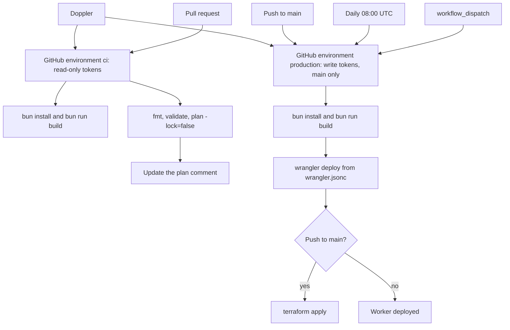

# ADR 0001: Deploy clzmj.dev with Workers and Terraform

## Status

Accepted

## Context

clzmj.dev is a static Next.js export. Bun builds it, `output: 'export'` writes `out/`, and the site renders a GitHub contributions graph at build time. The zone already has Google Workspace mail and domain-verification DNS records, plus a proxied `www` address. The apex does not resolve yet.

The Cloudflare API token used from CI is limited to this zone and to Workers. It cannot manage the zone resource or account-level zone settings. The account is a personal account, and the monthly cost has to stay at zero.

## Decision

### The Worker script stays in wrangler.jsonc

The site pull request adds the only Worker config: root `wrangler.jsonc`, Worker name `clzmj-dev`, static assets from `out/`. Terraform does not define the Worker script, its versions, or its asset settings (`html_handling`, `not_found_handling`). Those would drift from Wrangler on the next deploy, and Terraform would race the upload.

Terraform owns the edge around that Worker:

- the existing proxied `www` DNS record, adopted with an `import` block
- the existing dynamic redirect ruleset
- Always Use HTTPS, minimum TLS 1.2, and HSTS
- the Workers custom domain from `clzmj.dev` to `clzmj-dev`

The zone itself is a data source. The custom domain creates the apex DNS record as part of attaching the hostname, so Terraform does not declare that record a second time.

### Deploy with Wrangler, not the cf CLI

`cf deploy` reads `cloudflare.config.ts`. It does not read `wrangler.jsonc`. On a project that only has the Wrangler file, `cf` either fails or writes a new config and ignores the Worker name, assets directory, and bindings. That would be a second source of truth. The workflows run `bunx wrangler@4.156.2 deploy` from the repository root after `bun run build`.

### Deploy, then apply

`cloudflare_workers_custom_domain` points at a Worker that must already exist. On `main` the deploy job uploads the Worker, and the apply job runs only after that job succeeds. A daily schedule and `workflow_dispatch` rebuild and deploy the Worker so the contributions graph stays current. They do not apply Terraform. Nothing in the schedule changes the zone.

Production runs share the concurrency group `clzmj-dev-production` with `cancel-in-progress: false`, so two applies cannot run at once.

### Secrets come from Doppler

Doppler syncs two GitHub environments. Both use the same six names: `CLOUDFLARE_API_TOKEN`, `CLOUDFLARE_ACCOUNT_ID`, `CLOUDFLARE_ZONE_ID`, `TF_STATE_BUCKET`, `TF_STATE_R2_ACCESS_KEY_ID`, and `TF_STATE_R2_SECRET_ACCESS_KEY`. There are no repository-level secrets. Edit the values in Doppler. GitHub only receives the sync.

`ci` holds read-only tokens and has no branch restriction. Pull request jobs set `environment: ci`. `production` holds write tokens and allows deployments from `main` only. The push, schedule, and manual jobs set `environment: production`.

Terraform state is an S3 backend on R2 with `use_lockfile = true`. CI maps the R2 keys to `AWS_ACCESS_KEY_ID` and `AWS_SECRET_ACCESS_KEY`. The `ci` token can read the state bucket and cannot write the lock object, so pull requests use `terraform plan -lock=false`. Apply, on the write token, takes the lock.

Build steps never receive the Cloudflare or R2 secrets. Pull requests do not deploy a Worker preview. Preview the site locally, or with a Cloudflare quick tunnel.

### Redirect and DKIM

Public requests to `http://www.clzmj.dev` and `https://www.clzmj.dev` return a single 301 to `https://clzmj.dev`, keeping the path, the trailing slash, and the query string. The imported ruleset matches the live rule: name `default`, host equals `www.clzmj.dev`, dynamic target `concat("https://clzmj.dev", http.request.uri.path)`, status 301, preserve the query string, description `Redirect www to clzmj.dev`.

Google Workspace mail and verification records stay in the Cloudflare zone unmanaged by Terraform on purpose. Google issued these records; never change them.

### Zone hardening that stays free

Always Use HTTPS, TLS 1.2, and HSTS (one year, include subdomains, `nosniff`, preload off) are free zone settings. They are imported, because every zone already has the settings, and updated only where the live value differs. The read-only plan showed Always Use HTTPS off, minimum TLS 1.0, and HSTS disabled. Preload stays off. Submitting the domain to the preload list is hard to undo.

There is no zone cache rule. A Worker on a custom domain runs in front of the zone cache, so a cache rule would not apply. Workers static assets already cache at the edge (`Cache-Control: public, max-age=0, must-revalidate`, an `ETag`, and `CF-Cache-Status`). `cache.enabled` in Wrangler is a different product and would bill static asset requests that are otherwise free. `wrangler.jsonc` should leave it off.

## Deploy flow

## Consequences

- The first production apply imports the existing DNS and redirect ruleset with no changes, updates Always Use HTTPS, minimum TLS, and HSTS, and creates the apex custom domain.
- Applying before the first successful `wrangler deploy` fails, because the custom domain has no Worker to attach.
- The site build and the Worker config land in another pull request. Until `package.json` and `wrangler.jsonc` are on the ref, the workflows fail those checks instead of skipping them.
