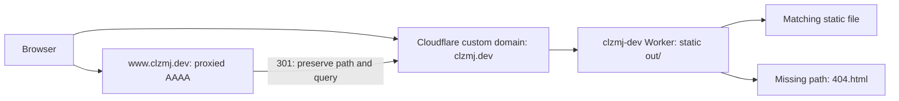
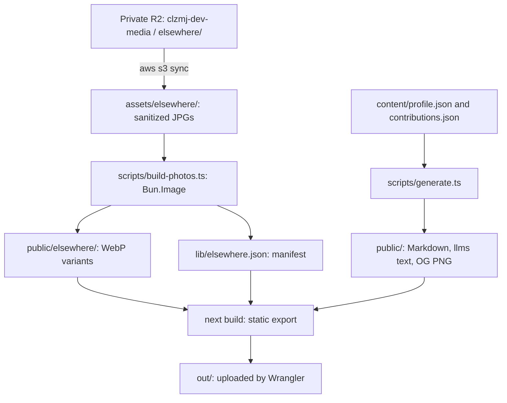

# Architecture

Trace requests and build inputs to the static site served at `clzmj.dev`.

## Requests

| Part                | Configuration                                                                                                   |
| ------------------- | --------------------------------------------------------------------------------------------------------------- |
| Apex → Worker       | `infra/custom_domain.tf`, `infra/locals.tf`; custom domain owns the apex attachment                             |
| www → apex          | `infra/dns.tf`, `infra/redirects.tf`; target `https://clzmj.dev` plus request path, query preserved             |
| Static assets / 404 | `wrangler.jsonc`: `assets.directory: ./out`, `not_found_handling: 404-page`; page in `app/not-found.tsx`        |
| HTTPS               | `infra/settings.tf`: Always Use HTTPS, minimum TLS 1.2, HSTS 31536000 seconds, subdomains included, preload off |

## Build inputs and outputs

| Stage         | Details                                                                                                                                           |
| ------------- | ------------------------------------------------------------------------------------------------------------------------------------------------- |
| Fetch         | Both workflows download the `elsewhere/` prefix before building; source bucket declared in `infra/r2.tf`                                          |
| Photos        | `scripts/build-photos.ts` audits metadata, writes WebPs and updates `lib/elsewhere.json`; see [photos](photos.md)                                 |
| Generate      | `scripts/generate.ts`: `homeMarkdown()`, `llmsText()`, Chromium-rendered `public/og/home.png`                                                     |
| Contributions | `refreshContributions()` refreshes only with `REFRESH_CONTRIBUTIONS=true` or `CONTRIBUTIONS_TOKEN`; otherwise reuses `content/contributions.json` |
| Build hook    | `package.json`: `prebuild` runs photo build then generation before `next build`                                                                   |
| Export        | `next.config.ts`: `output: 'export'`, unoptimized Next images; `wrangler.jsonc` uploads `out/`                                                    |

The daily workflow rebuilds but does **not** set either contribution refresh variable. Its build
receives `GITHUB_TOKEN`, which `refreshContributions()` does not read
(`.github/workflows/deploy.yml`, `scripts/generate.ts`).

## Ownership

| Data or behavior                                             | Source                                                                                                                 |
| ------------------------------------------------------------ | ---------------------------------------------------------------------------------------------------------------------- |
| Home sections                                                | `app/page.tsx`; shared shell in `components/shell.tsx`                                                                 |
| Biography / contribution snapshot                            | `content/profile.json`, `content/contributions.json`                                                                   |
| Photo captions, alt text, focal points, generated dimensions | `lib/elsewhere.json`; `loadSlides()` in `lib/content.ts` builds same-origin URLs                                       |
| Photo originals                                              | Private R2, copied into ignored `assets/elsewhere/`; generated WebPs are also ignored (`.gitignore`)                   |
| Secrets                                                      | Doppler → GitHub environments; local upload keys stay in `clzmj-dev/dev` ([environments](environments.md))             |
| Deployment / edge resources                                  | Wrangler owns assets; Terraform owns domain, redirect, zone settings and media bucket (`wrangler.jsonc`, `infra/*.tf`) |

[CI checks and failure recovery](ci.md) · [Deployment and rollback](operations.md) ·
[Decisions](adr/README.md)
