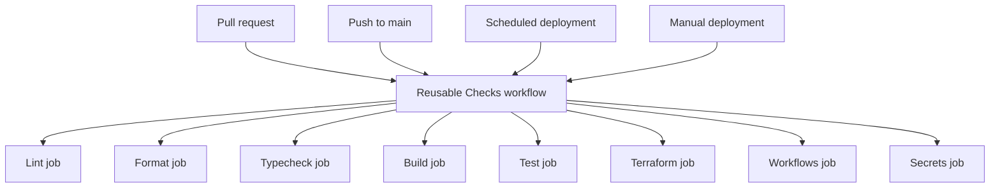
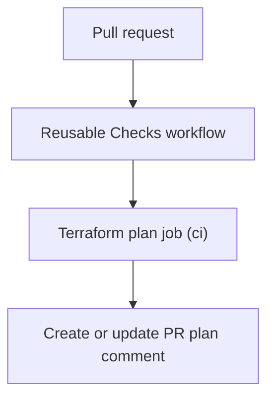
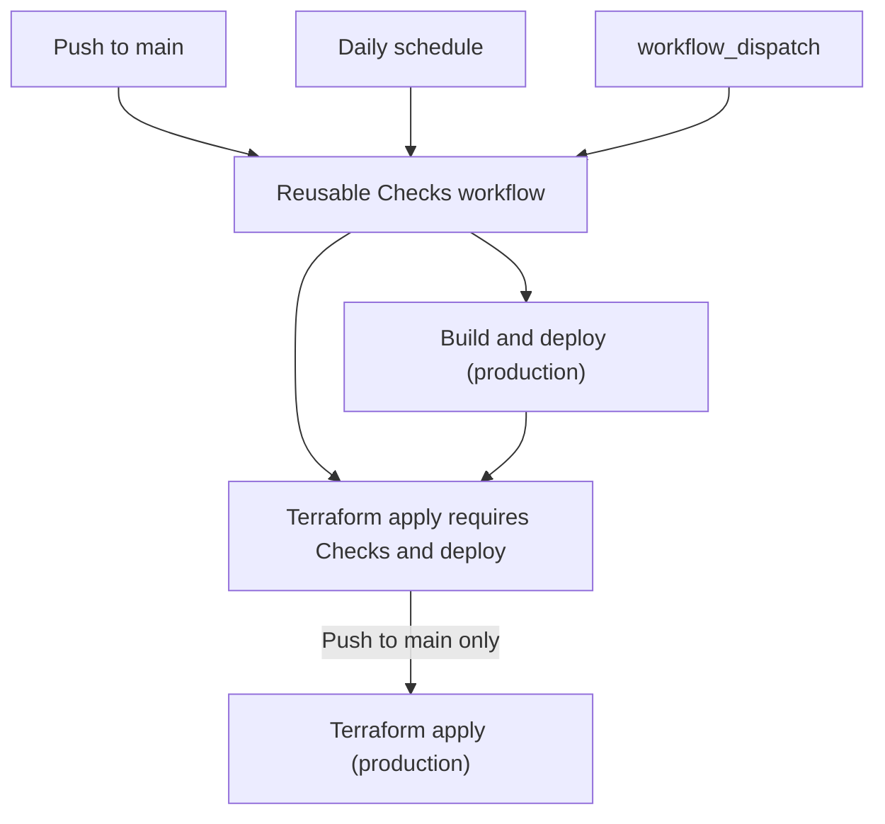

# CI checks and deployment

Pull requests and every production deployment trigger call the reusable workflow in
`.github/workflows/checks.yml`. Resolve a failing step at its source, then push the fix or rerun the
workflow if the failure was transient.

## Shared checks

| Job       | What it runs                                                                      | Environment |
| --------- | --------------------------------------------------------------------------------- | ----------- |
| Lint      | Bun 1.4.4, frozen install, `bun run lint`                                         | `ci`        |
| Format    | Bun 1.4.4, frozen install, `bun run format:check`                                 | `ci`        |
| Typecheck | Bun 1.4.4, frozen install, `bun run typecheck`                                    | `ci`        |
| Build     | Fetch private Elsewhere photos, install Chromium, `bun run build`, require `out/` | `ci`        |
| Test      | Independently fetch photos and build `out/`, then run Playwright Chromium tests   | `ci`        |
| Terraform | Format, backend-free init, validate, and TFLint                                   | None        |
| Workflows | actionlint and zizmor audits                                                      | None        |
| Secrets   | Full Git history scan with Gitleaks                                               | None        |

Each site job installs dependencies with `bun install --frozen-lockfile`; missing `package.json` or
both Bun lockfile forms (`bun.lock`, `bun.lockb`) fails the job. `Test` uploads `playwright-report/`
only after failure, ignores a missing report, and retains it for 7 days.

`bun run typecheck` runs `next typegen && tsc --noEmit` (`package.json`). The Terraform check uses
Terraform 1.17.1 and TFLint 0.65.0 (`.github/workflows/checks.yml`).

## Pull requests

Terraform plan waits for all reusable checks, downloads the nine allowlisted values from `clzmj-dev/ci` using the environment's scoped `DOPPLER_TOKEN`,
and verifies the state bucket. It runs `terraform plan -lock=false`, saves the output, and creates
or updates a PR comment even when planning fails. Fork PRs skip the credentialed plan.

| Job            | Dependency and access                                                           |
| -------------- | ------------------------------------------------------------------------------- |
| Checks         | Shared jobs run concurrently; `contents: read`                                  |
| Terraform plan | Needs Checks; `contents: read`, `pull-requests: write`; GitHub environment `ci` |

## Production

The production deploy job needs Checks; Terraform apply needs both Checks and a successful deploy,
and runs only on a push to `main`. Scheduled and manual runs deploy the Worker but skip Terraform
apply; production runs share a non-cancelling concurrency group.

| Trigger           | Result                                              |
| ----------------- | --------------------------------------------------- |
| Push to `main`    | Checks → Worker build/deploy → Terraform plan/apply |
| Daily `0 8 * * *` | Checks → Worker build/deploy; no apply              |
| Manual dispatch   | Checks → Worker build/deploy; no apply              |

## Failures

| Failure                         | Reproduce or fix                                                                                                                                                                                                                  |
| ------------------------------- | --------------------------------------------------------------------------------------------------------------------------------------------------------------------------------------------------------------------------------- |
| Setup / package guard / install | Restore `package.json` and a committed Bun lockfile. Reproduce with `bun install --frozen-lockfile`; inspect setup/cache failures before rerunning transient errors.                                                              |
| CLI download or install         | Workflows pins actionlint 1.7.12 and zizmor 1.32.0; Secrets pins Gitleaks 8.30.1. actionlint/Gitleaks archives must pass the downloaded checksum check before extraction. Inspect the failing install step.                       |
| Lint / format / typecheck       | Run `bun install --frozen-lockfile`, then `bun run lint`, `bun run format:check`, or `bun run typecheck`; format with `bun run format`.                                                                                           |
| Build / test                    | Install Chromium with `bunx playwright install --with-deps chromium`; check the four media secrets and R2 read access, run `bun run build`, then `bun run test --project=chromium --reporter=line,html`.                          |
| Terraform                       | From `infra/`, run `terraform fmt -check -recursive`, `terraform init -backend=false -input=false -no-color`, and `terraform validate -no-color`; fix formatting, provider, or validation errors.                                 |
| TFLint                          | From `infra/`, run `tflint --init --config=.tflint.hcl` then `tflint --config=.tflint.hcl --format=compact`; correct reported configuration issues.                                                                               |
| Workflows                       | Run `actionlint .github/workflows/*.yml` and `zizmor --offline .github/workflows`; fix the reported YAML or security findings.                                                                                                    |
| Secrets                         | Run `gitleaks git --redact --log-opts="--all" .`; remove exposed credentials from history and rotate any credential that was active.                                                                                              |
| PR plan / apply                 | Verify the environment-scoped `DOPPLER_TOKEN`, its project/config scope, runtime Doppler access, and required allowlisted values and that `TF_STATE_BUCKET` matches `infra/backend.tf`; inspect Terraform output before retrying. |
| Deploy                          | Verify `wrangler.jsonc`, production Cloudflare credentials, and successful `out/` build; see `docs/operations.md`.                                                                                                                |

Photo generation details are in `docs/photos.md`; environment values and secret setup are in
`docs/environments.md`.

The concrete workflow steps and permissions are defined in
`.github/workflows/checks.yml`, `.github/workflows/pull-request.yml`, and
`.github/workflows/deploy.yml`.
