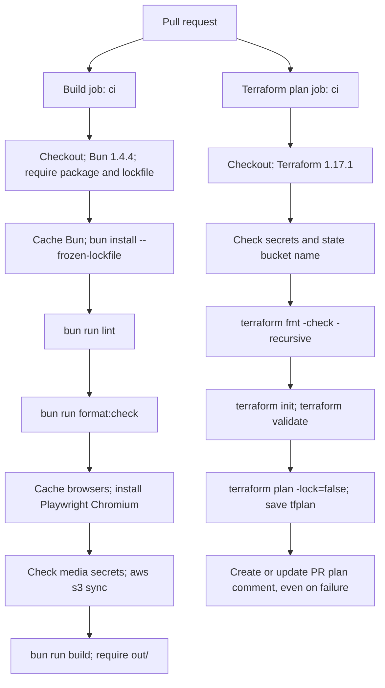
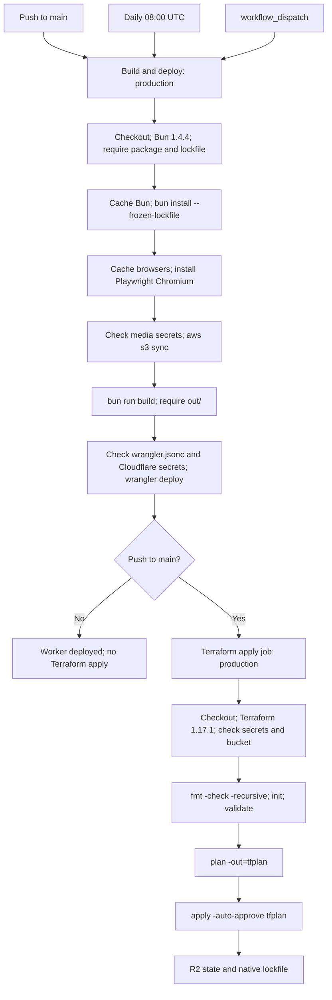

# CI checks and deployment

Find the failing step, reproduce its command, and rerun the workflow after fixing its inputs.

This section will be refreshed after the ci-gates PR.

## Pull requests

| Job     | Result / permissions                                                                                               |
| ------- | ------------------------------------------------------------------------------------------------------------------ |
| `build` | Lint, formatting and static build; `contents: read`                                                                |
| `plan`  | No state lock; captures `infra/plan.txt`, posts or updates one marked comment; additionally `pull-requests: write` |
| Both    | Independent jobs, GitHub environment `ci`; newer PR runs cancel older runs                                         |

Source: `.github/workflows/pull-request.yml`. Neither job runs `bun run test` or `bun run
typecheck`. Chromium installation supports build-time OG rendering, not a browser test step
(`scripts/generate.ts`).

## Production

| Trigger             | Runs today                                                                          |
| ------------------- | ----------------------------------------------------------------------------------- |
| Push to `main`      | Build → `bunx wrangler@4.156.2 deploy` → Terraform fmt/init/validate/plan/apply     |
| Daily `0 8 * * *`   | Build → Wrangler deploy; no Terraform job                                           |
| Manual dispatch     | Build → Wrangler deploy; no Terraform job                                           |
| All production runs | Shared `clzmj-dev-production` concurrency group; in-progress runs are not cancelled |

Source: `.github/workflows/deploy.yml`. Production runs no lint, format, typecheck or test command.
The daily build reuses the saved contributions unless refresh is explicitly enabled in the build
process (`scripts/generate.ts`); the workflow does not enable it.

## Failures

| Failing check or step        | What to do                                                                                                                                                     |
| ---------------------------- | -------------------------------------------------------------------------------------------------------------------------------------------------------------- |
| Checkout, setup, cache       | Read that action’s error; rerun transient failures. Versions and cache keys are pinned in the workflow files.                                                  |
| Require site package         | Restore `package.json` and `bun.lock`; the workflows fail rather than skipping missing app inputs.                                                             |
| Install                      | Run `bun install --frozen-lockfile`; resolve lockfile/package mismatches before retrying.                                                                      |
| Lint                         | Run `bun run lint`; warnings fail under `.oxlintrc.json`.                                                                                                      |
| Formatting                   | Run `bun run format` on changed files, then `bun run format:check`; settings are in `.oxfmtrc.json`.                                                           |
| Chromium install / OG render | Run `bunx playwright install chromium`; inspect `scripts/generate.ts` errors.                                                                                  |
| Fetch photos                 | Verify the four media/account secrets in the job’s GitHub environment via Doppler; inspect bucket/prefix and read access. See [environments](environments.md). |
| Photo generation             | Check missing IDs, metadata, focal points and output caps from `scripts/build-photos.ts`; follow [photos](photos.md).                                          |
| Next build / missing `out/`  | Run `bun run build`; keep `output: 'export'` in `next.config.ts`.                                                                                              |
| Wrangler deploy              | Verify `wrangler.jsonc`, production Cloudflare token/account and built `out/`; use [operations](operations.md).                                                |
| Terraform secret guard       | Match all required names in [environments](environments.md); `TF_STATE_BUCKET` must match `infra/backend.tf`.                                                  |
| Terraform fmt / validate     | Run the local commands in `infra/README.md`; fix configuration errors shown in the log.                                                                        |
| Terraform init / plan        | Check state R2 credentials, account/zone selectors and provider permissions. PR plans need read access and `-lock=false`.                                      |
| PR comment                   | Inspect the `plan` job’s `pull-requests: write` permission and action error; the comment step runs even when planning fails.                                   |
| Terraform apply              | Read the failed resource and saved plan log; verify the preceding Worker deploy succeeded. Fix and push to `main` for another apply.                           |

Sources: `.github/workflows/pull-request.yml`, `.github/workflows/deploy.yml`, `infra/backend.tf`.
The Worker may already be updated when Terraform apply fails because `apply` depends on `deploy`.

For checks outside today’s workflows: `bun run typecheck`; then build and run `bun run test`.
`playwright.config.ts` requires Chromium and WebKit; tests serve `out/` via `scripts/serve.ts`.
