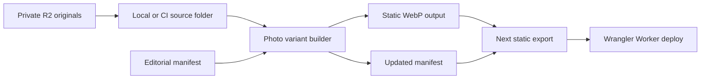

# Elsewhere photos

Replace a sanitized source photo, review its crop and publish it through the static build.

## End-to-end flow



1. **Fetch the originals.** The private bucket is `clzmj-dev-media`, prefix `elsewhere/`.
   Use `assets/elsewhere/`, or point `ELSEWHERE_SRC` at another local folder. (`infra/README.md`, `scripts/build-photos.ts`)

   For a fresh checkout, supply the read-only media pair and account/bucket selectors from
   [environments](environments.md), then download as the workflow does:

   ```sh
   AWS_ACCESS_KEY_ID="$MEDIA_R2_ACCESS_KEY_ID" \
   AWS_SECRET_ACCESS_KEY="$MEDIA_R2_SECRET_ACCESS_KEY" AWS_DEFAULT_REGION=auto \
   aws s3 sync "s3://${MEDIA_R2_BUCKET}/elsewhere/" assets/elsewhere/ \
     --endpoint-url "https://${CLOUDFLARE_ACCOUNT_ID}.r2.cloudflarestorage.com" --only-show-errors
   ```

   Source: `.github/workflows/checks.yml`. The credentials are process variables;
   this command does not configure Doppler or store secrets.

2. **Sanitize before upload.** Prepare `01.jpg`–`17.jpg` with EXIF/GPS and descriptive metadata removed.
   Replace the chosen slot, for example `assets/elsewhere/03.jpg`; keep the other sources.
   The repo audits metadata but has no stripping command. (`scripts/image-metadata.ts`, `scripts/build-photos.ts`)

   JPEG APP1 (EXIF/XMP, including GPS), APP13 and comments are rejected.
   PNG/WebP metadata chunks are also detected; generated WebPs are audited. (`scripts/image-metadata.ts`, `tests/image-metadata.spec.ts`)

3. **Edit the manifest.** In `lib/elsewhere.json`, edit `id`, `caption`, `alt` and normalized `focal` coordinates.
   Keep all 17 IDs in order. Adding an 18th entry fails the current count check.
   Use a lowercase caption of at most five words and a distinct descriptive `alt`. (`lib/elsewhere.json`, `lib/elsewhere.ts`, `scripts/build-photos.ts`, `tests/short-captions.spec.ts`)

   The builder derives output paths, dimensions, byte counts, object positions, colors and size attempts.
   Do not hand-edit generated fields. (`scripts/build-photos.ts`)

4. **Build variants.** Run `bun run build`; `prebuild` runs the photo builder, then `scripts/generate.ts`.
   Bun >= 1.3.14 and all 17 source files are required. (`package.json`, `README.md`)

   Variants try 640, 1080, 1600, 2400 and native width capped at 2400; they never upscale.
   Quality steps are q85/q80/q75; caps are 300,000 bytes through 640px, then 600,000 bytes.
   (`scripts/build-photos.ts`, `scripts/photo-output-policy.ts`)

   A 1920px HD fallback is tried when a larger output is rejected.
   The build fails if no valid size meets the HD requirement. (`scripts/build-photos.ts`)

5. **Review the outputs.** WebPs go in `public/elsewhere/`; generated metadata is written to `lib/elsewhere.json`.
   Both photo directories are gitignored and tests reject tracked files there. (`scripts/build-photos.ts`, `.gitignore`, `tests/image-metadata.spec.ts`)

6. **Preview locally.** `bun run start` serves `out/` on port 3000. (`scripts/serve.ts`)
   If installed, `cloudflared tunnel --url http://127.0.0.1:3000` exposes a quick preview.
   The repo does not configure cloudflared.

7. **Upload changed sources.** After local review, use the dev upload pair in Doppler.
   This sync uploads changed files; keep only sanitized numbered JPGs in the source folder.
   Credentials and command: `infra/README.md`.

   ```sh
   doppler run --project clzmj-dev --config dev -- sh -c 'AWS_ACCESS_KEY_ID=$MEDIA_R2_UPLOAD_ACCESS_KEY_ID \
   AWS_SECRET_ACCESS_KEY=$MEDIA_R2_UPLOAD_SECRET_ACCESS_KEY AWS_DEFAULT_REGION=auto \
   aws s3 sync assets/elsewhere/ s3://clzmj-dev-media/elsewhere/ --endpoint-url \
   https://51d0a4728b8e02a6abfa1e2560252613.r2.cloudflarestorage.com'
   ```

   R2 replacements affect the next build, including scheduled builds. Keep a private copy of
   the old sanitized source for recovery; neither photo directory belongs in Git (`.gitignore`).

8. **Deploy.** Commit the changed `lib/elsewhere.json` in a PR; merge to `main` after review.
   All reusable checks must pass before the production job fetches originals, rebuilds `out/`
   and deploys Worker assets (`.github/workflows/checks.yml`, `.github/workflows/deploy.yml`).

   R2 remains private source storage; workflows do not set `ELSEWHERE_BASE_URL`.
   (`.github/workflows/deploy.yml`, `README.md`, `infra/README.md`, `lib/content.ts`)

   The default asset path is `/elsewhere`; `ELSEWHERE_BASE_URL` can change the same-origin path.
   This variable does not configure an R2 mount. (`lib/content.ts`)

## Crops and output policy

`main()` in `scripts/build-photos.ts` converts normalized `focal` into CSS percentages. `PhotoFan`
in `components/photo-fan.tsx` applies `objectPosition` inside 4:5 frames (`app/globals.css`); pixels
keep their source aspect ratio.

| Example in `lib/elsewhere.json` | `focal`                  | Generated `objectPosition` |
| ------------------------------- | ------------------------ | -------------------------- |
| Paris, `04`                     | `{ "x": 0.5, "y": 0.5 }` | `50% 50%`                  |
| Photo `13`                      | `{ "x": 0.5, "y": 0.5 }` | `50% 50%`                  |
| Photo `14`                      | `{ "x": 0.5, "y": 0.5 }` | `50% 50%`                  |
| Moving day, `15`                | `{ "x": 0.8, "y": 0.5 }` | `80% 50%`                  |

`photoQuality()` in `scripts/photo-output-policy.ts` starts photo `02` at q80 for 2400px. Other
sizes start at q85; widths that exceed the cap even at q75 are omitted and recorded.

## Photo fan and tests

The fan renders 7/7/3 cards and shuffles on page load; no-JavaScript markup keeps manifest order.
Images are lazy-loaded with `srcSet` and manifest focal positions. (`components/photo-fan.tsx`,
`lib/elsewhere-shuffle.ts`, `docs/design.md`)

Base UI owns dialog lifecycle, dismissal, focus and scroll lock. Motion animates a separate
shared-layout figure. (`components/photo-fan.tsx`, `components/ui/dialog.tsx`)

`playwright.config.ts` configures Chromium and iPhone 15 WebKit at 393×852.

Photo tests cover metadata, budgets, dimensions, crops, shuffle, keyboard, dismissal, motion and
restoration. (`tests/image-metadata.spec.ts`, `tests/photos.spec.ts`, `tests/photo-shuffle.spec.ts`,
`tests/viewer-scroll.spec.ts`)

Install both browsers and run the photo suites against the built export (`package.json`,
`playwright.config.ts`):

```sh
bunx playwright install chromium webkit
bun run build
bun run test tests/image-metadata.spec.ts tests/photos.spec.ts tests/short-captions.spec.ts tests/photo-shuffle.spec.ts tests/viewer-scroll.spec.ts
```

CI builds again in the Test job and runs Chromium only with `bun run test --project=chromium
--reporter=line,html`. On failure, its Playwright report is kept for seven days
(`.github/workflows/checks.yml`); run WebKit locally for mobile coverage.

## Known issues

There is no repository tool to strip EXIF/GPS; metadata-bearing sources fail the build. Sanitize
sources before upload. (`scripts/image-metadata.ts`, `scripts/build-photos.ts`)

Viewer close and page restoration are covered for outside press, Escape, browser back, swipe, focus
return and scroll restoration in `tests/viewer-scroll.spec.ts`.
