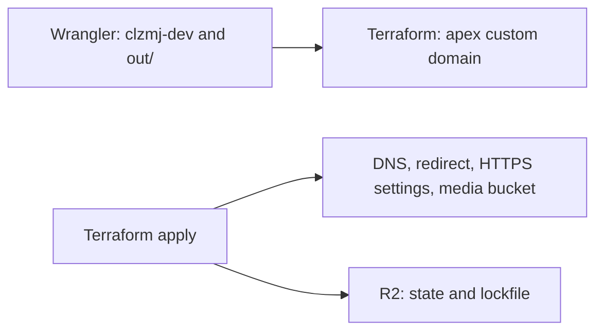

# Infrastructure

Terraform owns Cloudflare resources around the Worker; Wrangler uploads the static site.



| Owner                    | Source                                                                  |
| ------------------------ | ----------------------------------------------------------------------- |
| Worker script / assets   | Root `wrangler.jsonc`; deploy command in `.github/workflows/deploy.yml` |
| Edge and media resources | `infra/*.tf`; apply runs only after Worker deploy on a `main` push      |
| Existing zone            | `infra/zone.tf` reads it as a data source and verifies the name         |

## Resources and buckets

| Resource           | Terraform address / file                                          | Behavior                                                                   |
| ------------------ | ----------------------------------------------------------------- | -------------------------------------------------------------------------- |
| Apex custom domain | `cloudflare_workers_custom_domain.apex`, `infra/custom_domain.tf` | `clzmj.dev` → `clzmj-dev`; custom domain handles apex DNS                  |
| www DNS            | `cloudflare_dns_record.www_aaaa`, `infra/dns.tf`                  | Proxied AAAA `100::`, TTL auto; redirect placeholder                       |
| www redirect       | `cloudflare_ruleset.www_redirect`, `infra/redirects.tf`           | Single rule: 301 to HTTPS apex, keeping path and query                     |
| HTTPS enforcement  | `cloudflare_zone_setting.always_use_https`, `infra/settings.tf`   | `on`                                                                       |
| Minimum TLS        | `cloudflare_zone_setting.min_tls_version`, `infra/settings.tf`    | `1.2`                                                                      |
| HSTS               | `cloudflare_zone_setting.security_header`, `infra/settings.tf`    | 31536000 seconds, include subdomains, nosniff; preload off                 |
| Media R2 bucket    | `cloudflare_r2_bucket.media`, `infra/r2.tf`                       | `clzmj-dev-media`, default jurisdiction, WNAM, Standard; `prevent_destroy` |
| State R2 bucket    | Backend in `infra/backend.tf`; not a managed bucket resource      | `clzmj-dev-tfstate`, key `clzmj.dev/terraform.tfstate`, native lockfile    |

`infra/imports.tf` adopts the existing www record, redirect ruleset, zone settings and media bucket.
Mail and domain-verification DNS records are not declared in `infra/*.tf`.

No public media domain or runtime R2 binding is configured in `infra/` or `wrangler.jsonc`.

## Credential contract

Doppler is the source of truth and syncs GitHub environment secrets automatically. Change the source
in Doppler, not the synced destination in GitHub. The documented setup uses environment secrets,
with no repository-level secrets.

The integration configuration is not versioned in this repository.

| Destination             | Access                                                                                                | Workflow                                                    |
| ----------------------- | ----------------------------------------------------------------------------------------------------- | ----------------------------------------------------------- |
| GitHub `ci`             | Read-only Cloudflare and state; no branch restriction documented by the existing infrastructure setup | Reusable site checks on all triggers; PR `plan -lock=false` |
| GitHub `production`     | Write Cloudflare and state; `main` only in the documented environment setup                           | Worker deploy; Terraform apply only on `main` pushes        |
| Doppler `clzmj-dev/dev` | Local media upload keys; no GitHub sync target recorded                                               | Mac upload command below                                    |

Both GitHub environments receive the nine Doppler-synced names listed in
[environments](../docs/environments.md#every-secret-read-by-workflows).

The media read pair is scoped to `clzmj-dev-media`; both environments use read-only media
credentials. Cloudflare tokens include Workers R2 Storage Read in `ci` and Workers R2 Storage Write
in production.

Actual token policies and branch restrictions must be verified outside the repository.

The state pair maps to `AWS_ACCESS_KEY_ID` / `AWS_SECRET_ACCESS_KEY` in Terraform steps. `ci` cannot
write the state lock, so PR plans use `-lock=false`; production apply takes the lock.

Sources: `.github/workflows/pull-request.yml`, `.github/workflows/deploy.yml`, `infra/backend.tf`.

## Upload sanitized media from the Mac

`MEDIA_R2_UPLOAD_ACCESS_KEY_ID` and `MEDIA_R2_UPLOAD_SECRET_ACCESS_KEY` live only in Doppler
`clzmj-dev/dev`. The private bucket holds `elsewhere/01.jpg`–`17.jpg`; `.gitignore` excludes both
source photos and generated WebPs.

```sh
doppler run --project clzmj-dev --config dev -- sh -c 'AWS_ACCESS_KEY_ID=$MEDIA_R2_UPLOAD_ACCESS_KEY_ID AWS_SECRET_ACCESS_KEY=$MEDIA_R2_UPLOAD_SECRET_ACCESS_KEY AWS_DEFAULT_REGION=auto aws s3 sync assets/elsewhere/ s3://clzmj-dev-media/elsewhere/ --endpoint-url https://51d0a4728b8e02a6abfa1e2560252613.r2.cloudflarestorage.com'
```

See [photos](../docs/photos.md) for metadata checks, crops and safe replacement steps. Workflows
fetch sources before building; browsers receive generated files from `out/`.

## Local Terraform checks

Run from the repository root; these commands avoid remote state access. Versions:
`infra/versions.tf`; CI pins Terraform 1.17.1 in `.github/workflows/checks.yml`, `pull-request.yml`
and `deploy.yml`.

```sh
terraform -chdir=infra fmt -check -recursive
terraform -chdir=infra init -backend=false
terraform -chdir=infra validate
tflint --chdir=infra --init --config=.tflint.hcl
tflint --chdir=infra --config=.tflint.hcl --format=compact
```

The reusable Terraform check runs fmt → backend-free init → validate → TFLint without state
credentials (`.github/workflows/checks.yml`, `infra/.tflint.hcl`).

After all eight checks pass, a PR runs fmt → init → validate → `plan -lock=false -out=tfplan` and
updates its plan comment (`.github/workflows/pull-request.yml`).

A `main` push runs all checks → Worker build/deploy → Terraform fmt/init/validate/plan/apply.
Scheduled and manual runs also require all checks, then build/deploy without apply
(`.github/workflows/deploy.yml`).

[All environment secrets](../docs/environments.md) · [CI failures](../docs/ci.md) · [Deployment and
rollback](../docs/operations.md) · [ADRs](../docs/adr/README.md)
